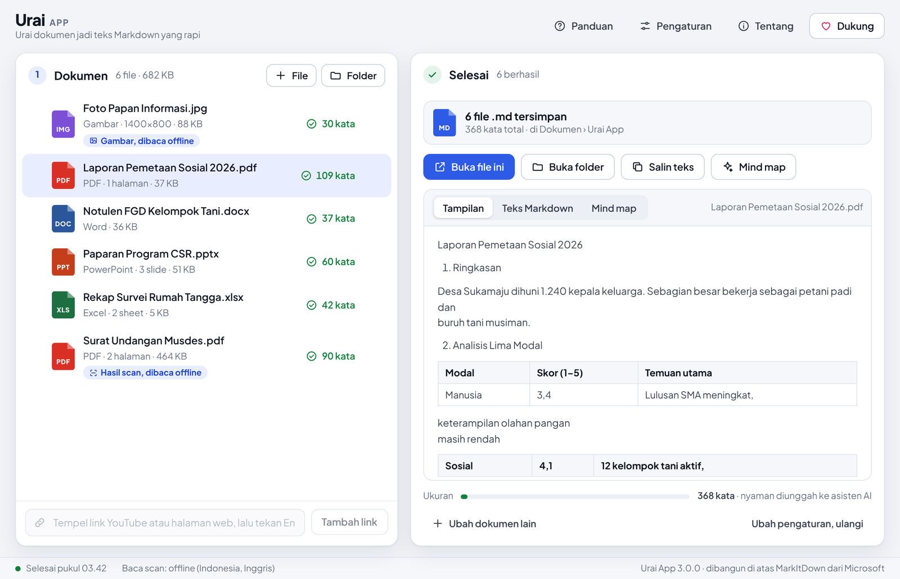
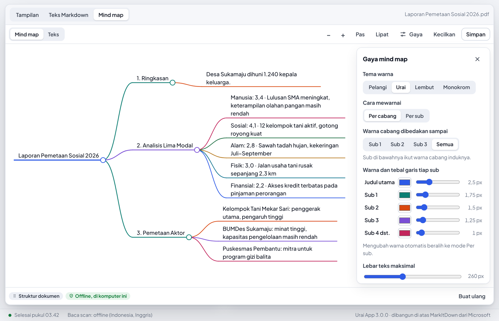
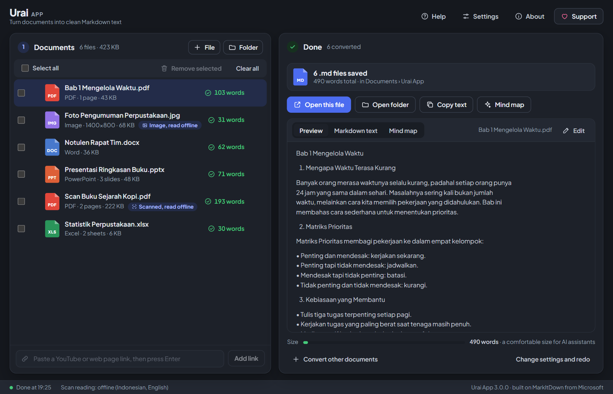

# Urai App

[English](README.md) · **Bahasa Indonesia**

**Urai dokumen jadi teks Markdown yang rapi.** Aplikasi Windows gratis dan open source untuk mengubah PDF, Word, PowerPoint, Excel, gambar, rekaman suara, dan link YouTube menjadi file Markdown (`.md`) yang siap diunggah ke ChatGPT, Claude, Gemini, atau NotebookLM. Dibangun di atas [MarkItDown](https://github.com/microsoft/markitdown) dari Microsoft, dengan tampilan yang mudah untuk orang awam.



## Fitur

- **Tarik dan lepas.** Tarik banyak file atau satu folder penuh ke jendela. Bisa juga klik kanan file di File Explorer, lalu **Kirim ke › Urai App**.
- **Satu file per dokumen, atau gabung jadi satu.** Urutan isi file gabungan diatur dengan menyeret daftar.
- **Baca PDF hasil scan dan gambar tanpa internet.** Memakai Tesseract OCR yang ikut terpasang, berjalan di prosesor. Bahasa Indonesia, Inggris, Jawa, Sunda, dan Arab. PDF hasil scan dikenali otomatis.
- **Mode AI (opsional).** Pakai API key Anda sendiri dari Claude, Gemini, DeepSeek, OpenAI, OpenRouter, atau server lain yang kompatibel. Lebih akurat untuk scan buram dan bisa menjelaskan grafik.
- **Baca gambar di dalam Word, PowerPoint, dan Excel**, misalnya grafik atau tabel yang ditempel sebagai gambar.
- **Mind map.** Ubah hasil menjadi mind map interaktif seperti [markmap](https://markmap.js.org), dari struktur dokumen (gratis, offline) atau rangkuman AI (jenis Poin utama, Notulen, Ringkas lengkap). Warna dan tebal garis bisa diatur per sub. Simpan sebagai PDF siap cetak (A4, A3, F4), PNG, HTML interaktif, atau Markdown.
- **Eksperimental:** transkrip video YouTube dan rekaman suara ke teks.
- **Dua bahasa dan tiga tema.** Tampilan berbahasa Inggris (bawaan) atau Indonesia, dengan tema terang, gelap, atau mengikuti Windows. Atur di **Pengaturan › Umum**.





## Unduh dan pasang

1. Buka halaman **[Releases](../../releases)** di repo ini (atau tautan Google Drive resmi dari pengembang).
2. Unduh `UraiApp-3.0.0-Setup.exe`, lalu jalankan. Tidak perlu hak admin; aplikasi dipasang untuk akun Windows Anda saja.
3. Karena installer belum ditandatangani secara digital, Windows mungkin menampilkan **"Windows melindungi PC Anda"**. Tekan **Info selengkapnya › Tetap jalankan**. Periksa dulu bahwa file berasal dari halaman resmi; kode SHA-256 setiap file ada di `SHA256SUMS.txt`.

Butuh Windows 10 atau 11 (64-bit) dengan Microsoft Edge WebView2 Runtime. WebView2 sudah ada di Windows 11 dan Windows 10 yang rutin diperbarui; bila belum ada, installer akan memberi tahu.

Tidak ingin memasang? Unduh `UraiApp-3.0.0-portable.zip`, ekstrak, lalu jalankan `Urai App.exe`.

**Menghapus:** Pengaturan Windows › Aplikasi › Aplikasi terinstal › Urai App › Copot. Pengaturan dan API key tersimpan di `%APPDATA%\UraiApp` dan Windows Credential Manager; hapus manual bila ingin bersih sepenuhnya.

## Cara pakai

1. **Tambahkan dokumen**: tarik ke jendela, atau tekan **File** / **Folder**. Link YouTube dan halaman web ditempel di kolom bawah.
2. **Atur hasil**: pilih satu file per dokumen atau gabung jadi satu, cara membaca scan (Mati, Offline, AI), dan folder penyimpanan.
3. **Tekan tombol biru** (atau Ctrl + Enter). Hasil tersimpan di `Dokumen\Urai App`, bisa langsung dibuka, disalin, atau dibuat mind map.

Panduan lengkap ada di [docs/GUIDE.id.md](docs/GUIDE.id.md).

## Privasi

Urai App tidak mengumpulkan data dan tidak punya server. Dokumen hanya keluar dari komputer Anda bila Anda sendiri memakai:

- **mode AI** atau **Rangkuman AI**: dikirim ke penyedia AI pilihan Anda, memakai API key Anda;
- **link YouTube atau halaman web**: diambil langsung dari situsnya;
- **rekaman suara**: dikirim ke layanan pengenal suara Google.

API key disimpan di Windows Credential Manager, bukan di file biasa.

## Dukung pengembang

Semua fitur gratis. Bila Urai App bermanfaat, Anda bisa mentraktir kopi lewat QRIS GoPay Merchant atas nama **Elnola Studio, Digital &** dari tombol **Dukung** di aplikasi. Pastikan nama penerima di layar pembayaran sama sebelum membayar.

## Pertanyaan dan masalah

Laporkan masalah atau ajukan pertanyaan lewat tab **[Issues](../../issues)** di repo ini. Bila perlu, sertakan file catatan dari `%APPDATA%\UraiApp\logs\urai.log` (berisi nama file dan pesan error, bukan isi dokumen). Issues bersifat publik, jadi periksa dulu isi file catatan dan hapus nama file atau folder yang tidak ingin dibagikan.

---

## Untuk pengembang

### Susunan repo

```
src/urai/            kode aplikasi (Python)
  app.py             titik masuk: jendela pywebview, tarik-lepas, --selftest, --smoke, --dev
  api.py             jembatan tampilan <-> Python (window.pywebview.api.*)
  convert.py         konversi lewat MarkItDown, OCR PDF per halaman, file gabungan
  ocr.py             Tesseract (offline) lewat proses terpisah
  ai.py              penyedia AI yang kompatibel dengan API OpenAI
  summarize.py       kerangka mind map: struktur dokumen dan rangkuman AI bertahap
  export.py          simpan mind map: Markdown, HTML offline, PNG, PDF (ReportLab)
  settings.py        pengaturan JSON + API key di Windows Credential Manager
  web/               tampilan: index.html, app.css, app.js, pustaka markmap/d3, huruf
  samples/           file contoh untuk tombol "Coba dengan file contoh"
packaging/           PyInstaller, Inno Setup, unduh Tesseract, daftar lisensi
tests/               pytest (termasuk uji tampilan dengan Playwright)
.github/workflows/   uji dan rakit installer otomatis
```

### Menjalankan dari kode sumber

Butuh Python 3.12 dan, untuk baca scan offline, [Tesseract](https://github.com/UB-Mannheim/tesseract/wiki) dengan bahasa `ind` dan `eng`.

```bash
python -m venv .venv
.venv\Scripts\activate            # Linux/macOS: source .venv/bin/activate
pip install -r requirements-dev.txt
set PYTHONPATH=src                # Linux/macOS: export PYTHONPATH=src
python -m urai                    # jendela aplikasi (Windows)
python -m urai --dev              # tampilan di browser, untuk mengembangkan tampilan
```

### Uji

```bash
python -m pytest                                  # uji Python (uji OCR dilewati bila Tesseract tidak ada)
pip install playwright && playwright install chromium
URAI_E2E=1 python -m pytest tests/test_e2e.py     # uji tampilan menyeluruh di Chromium
```

### Merakit installer

Installer dirakit otomatis oleh GitHub Actions ([build.yml](.github/workflows/build.yml)) di setiap push ke `main`: hasilnya bisa diunduh dari tab **Actions** sebagai artifact. Saat tag `v3.0.0` didorong, installer, versi portable, dan `SHA256SUMS.txt` otomatis diunggah ke halaman Releases. Langkah lengkap, termasuk merakit di komputer sendiri, ada di [docs/BUILDING.id.md](docs/BUILDING.id.md).

## Lisensi

Urai App © 2026 mahesarnol, berlisensi [MIT](LICENSE). Urai App dibangun di atas MarkItDown dari Microsoft (lisensi MIT) dan tidak berafiliasi dengan Microsoft. Komponen pihak ketiga yang ikut dipasang (Tesseract OCR, PDFium, pywebview, markmap, d3, huruf Plus Jakarta Sans dan JetBrains Mono, dan lainnya) memakai lisensinya masing-masing; teks lengkapnya ada di `THIRD-PARTY-NOTICES.txt` di folder aplikasi.
