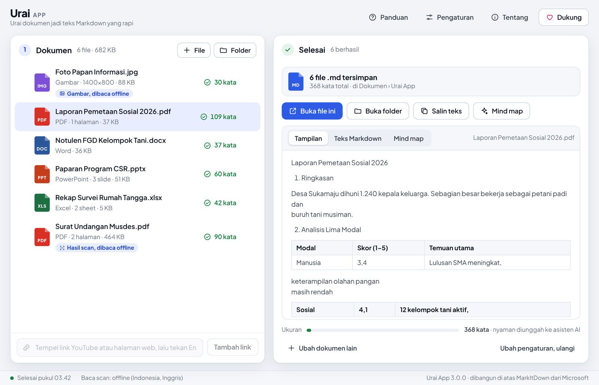
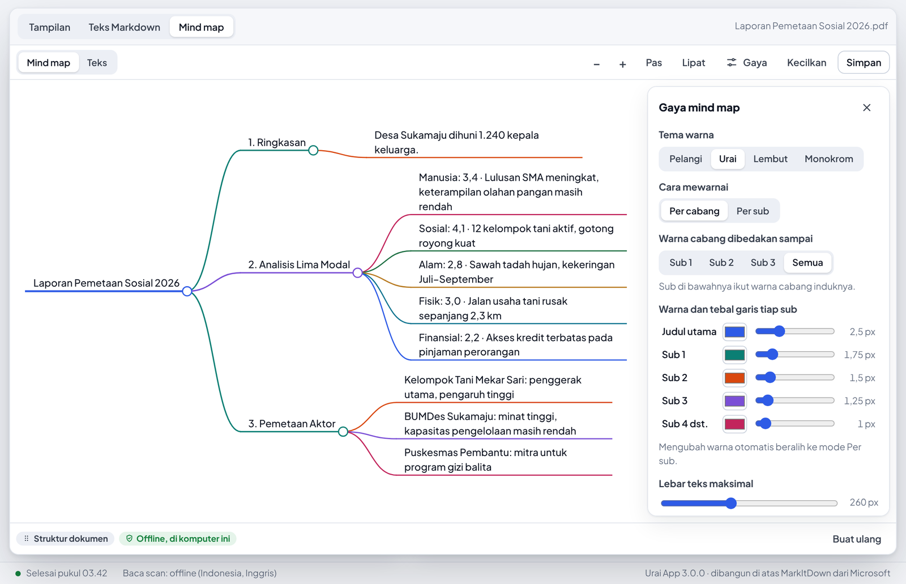
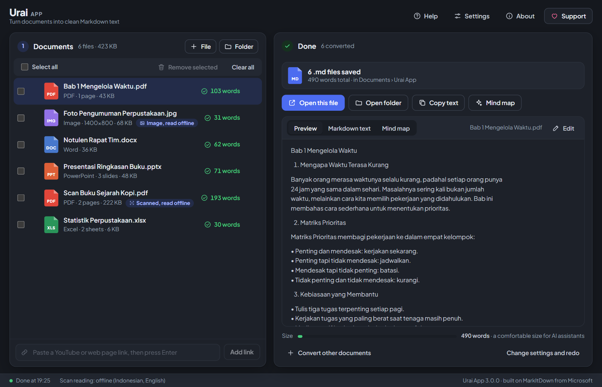

# Urai App

**English** · [Bahasa Indonesia](README.id.md)

**Turn documents into clean Markdown text.** A free, open-source Windows app that converts PDF, Word, PowerPoint, Excel, images, voice recordings, and YouTube links into Markdown (`.md`) files ready to upload to ChatGPT, Claude, Gemini, or NotebookLM. Built on Microsoft's [MarkItDown](https://github.com/microsoft/markitdown), with an interface that is easy for non-technical users.

> The app interface is in Indonesian. Button names below are written as they appear in the app, with an English translation in parentheses.



## Features

- **Drag and drop.** Drag many files or a whole folder onto the window. You can also right-click files in File Explorer and choose **Send to › Urai App**.
- **One file per document, or merge into one.** Reorder the contents of the merged file by dragging the list.
- **Read scanned PDFs and images offline.** Uses the bundled Tesseract OCR, running on your CPU. Supports Indonesian, English, Javanese, Sundanese, and Arabic. Scanned PDFs are detected automatically.
- **AI mode (optional).** Use your own API key from Claude, Gemini, DeepSeek, OpenAI, OpenRouter, or another compatible server. More accurate for blurry scans, and it can describe charts.
- **Read images inside Word, PowerPoint, and Excel**, such as charts or tables pasted as pictures.
- **Mind maps.** Turn results into interactive mind maps like [markmap](https://markmap.js.org), either from the document structure (free, offline) or from an AI summary (General, Minutes, or Report). Colors and line widths can be set per level. Save as print-ready PDF (A4, A3, F4), PNG, interactive HTML, or Markdown.
- **Experimental:** YouTube video transcripts and speech-to-text for voice recordings.
- **Light and dark themes** that follow your Windows setting.





## Download and install

1. Open the **[Releases](../../releases)** page of this repo (or the developer's official Google Drive link).
2. Download `UraiApp-3.0.0-Setup.exe` and run it. No admin rights are needed; the app is installed for your Windows account only.
3. Because the installer is not digitally signed yet, Windows may show **"Windows protected your PC"**. Click **More info › Run anyway**. First make sure the file came from the official page; the SHA-256 hash of every file is listed in `SHA256SUMS.txt`.

Requires Windows 10 or 11 (64-bit) with the Microsoft Edge WebView2 Runtime. WebView2 is already included in Windows 11 and in regularly updated Windows 10; if it is missing, the installer will tell you.

Prefer not to install? Download `UraiApp-3.0.0-portable.zip`, extract it, and run `Urai App.exe`.

**Uninstalling:** Windows Settings › Apps › Installed apps › Urai App › Uninstall. Settings and API keys are stored in `%APPDATA%\UraiApp` and Windows Credential Manager; delete them manually for a completely clean removal.

## How to use

1. **Add documents**: drag them onto the window, or press **File** / **Folder**. Paste YouTube links and web pages into the field at the bottom.
2. **Set up the output**: choose one file per document or a single merged file, how to read scans (**Mati** (Off), **Offline**, or **AI**), and where to save.
3. **Press the blue button** (or Ctrl + Enter). Results are saved to `Documents\Urai App`, ready to open, copy, or turn into a mind map.

The full guide is in [docs/GUIDE.md](docs/GUIDE.md).

## Privacy

Urai App collects no data and has no server. Documents only leave your computer when you yourself use:

- **AI mode** or **AI summary**: sent to the AI provider you choose, using your API key;
- **YouTube links or web pages**: fetched directly from the site;
- **voice recordings**: sent to Google's speech recognition service.

API keys are stored in Windows Credential Manager, not in a plain file.

## Support the developer

All features are free. If Urai App helps you, you can buy the developer a coffee via QRIS (Indonesia's QR payment standard) to the GoPay Merchant account **mahesarnol app**, from the **Dukung** (Support) button in the app. Make sure the recipient name matches before paying.

## Contact

Email maheswara.as@gmail.com · X [@mahesarnol](https://x.com/mahesarnol) · Instagram [@mahesarnol](https://instagram.com/mahesarnol)

Report problems in this repo's **Issues** tab. Please attach the log file from `%APPDATA%\UraiApp\logs\urai.log` (it contains file names and error messages, not document contents).

---

## For developers

### Repository layout

```
src/urai/            application code (Python)
  app.py             entry point: pywebview window, drag and drop, --selftest, --smoke, --dev
  api.py             UI <-> Python bridge (window.pywebview.api.*)
  convert.py         conversion via MarkItDown, per-page PDF OCR, merged files
  ocr.py             Tesseract (offline) in a separate process
  ai.py              AI providers compatible with the OpenAI API
  summarize.py       mind map outlines: document structure and staged AI summaries
  export.py          mind map export: Markdown, offline HTML, PNG, PDF (ReportLab)
  settings.py        JSON settings + API keys in Windows Credential Manager
  web/               UI: index.html, app.css, app.js, markmap/d3 libraries, fonts
  samples/           sample files for the "Coba dengan file contoh" (Try with sample files) button
packaging/           PyInstaller, Inno Setup, Tesseract download, license list
tests/               pytest (including UI tests with Playwright)
.github/workflows/   automated tests and installer builds
```

### Running from source

Requires Python 3.12 and, for offline scan reading, [Tesseract](https://github.com/UB-Mannheim/tesseract/wiki) with the `ind` and `eng` languages.

```bash
python -m venv .venv
.venv\Scripts\activate            # Linux/macOS: source .venv/bin/activate
pip install -r requirements-dev.txt
set PYTHONPATH=src                # Linux/macOS: export PYTHONPATH=src
python -m urai                    # app window (Windows)
python -m urai --dev              # UI in the browser, for front-end development
```

### Tests

```bash
python -m pytest                                  # Python tests (OCR tests are skipped if Tesseract is missing)
pip install playwright && playwright install chromium
URAI_E2E=1 python -m pytest tests/test_e2e.py     # end-to-end UI tests in Chromium
```

### Building the installer

The installer is built automatically by GitHub Actions ([build.yml](.github/workflows/build.yml)) on every push to `main`; the result can be downloaded from the **Actions** tab as an artifact. When the `v3.0.0` tag is pushed, the installer, the portable version, and `SHA256SUMS.txt` are uploaded to the Releases page automatically. Full steps, including building on your own computer, are in [docs/BUILDING.md](docs/BUILDING.md).

## License

Urai App © 2026 mahesarnol, licensed under [MIT](LICENSE). Urai App is built on Microsoft's MarkItDown (MIT license) and is not affiliated with Microsoft. Bundled third-party components (Tesseract OCR, PDFium, pywebview, markmap, d3, the Plus Jakarta Sans and JetBrains Mono fonts, and others) are under their own licenses; the full texts are in `THIRD-PARTY-NOTICES.txt` in the app folder.
